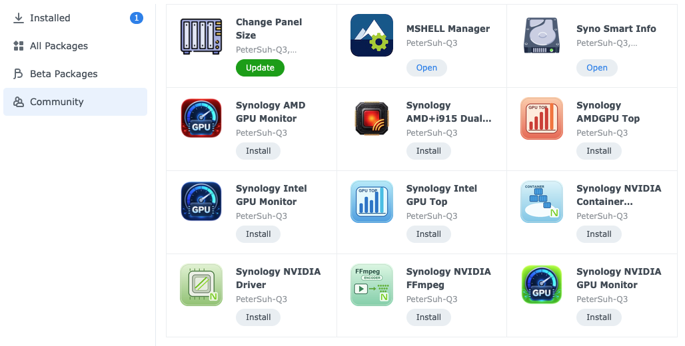

<!-- @format -->

> **DSM Package Center source:** Add [https://nas.dante90.mmv.kr/](https://nas.dante90.mmv.kr/) in **Package Center → Settings → Package Sources** to browse compatible PeterSuh-Q3 packages.

The package uses a narrowly scoped DSM privilege tool for storage-panel changes; no sudoers configuration is required.

## License

This repository is licensed under the [MIT License](LICENSE).

This work is not affiliated with Synology Inc. in any way. It is an independent project. It is not an official Synology product and does not have any official support from Synology Inc. Use at your own risk.
